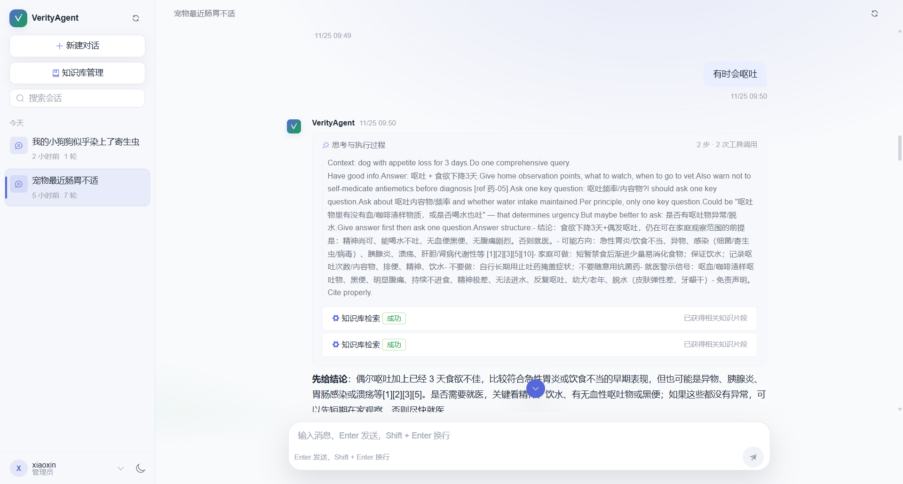
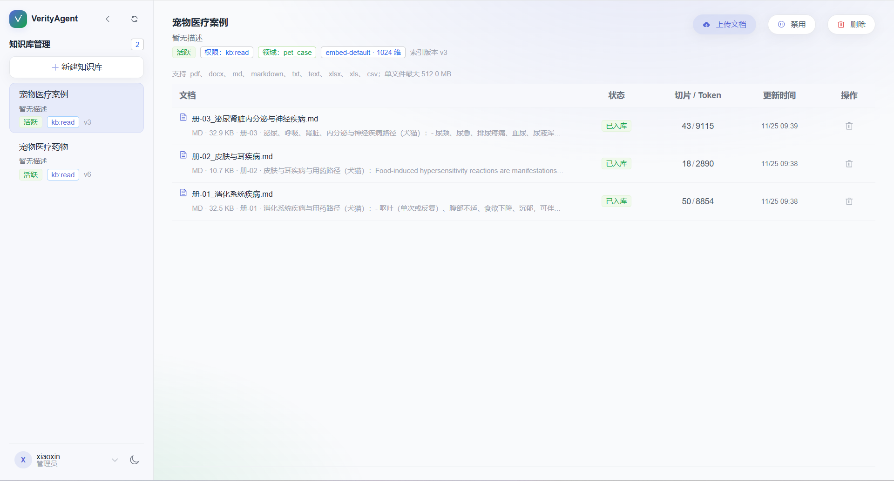
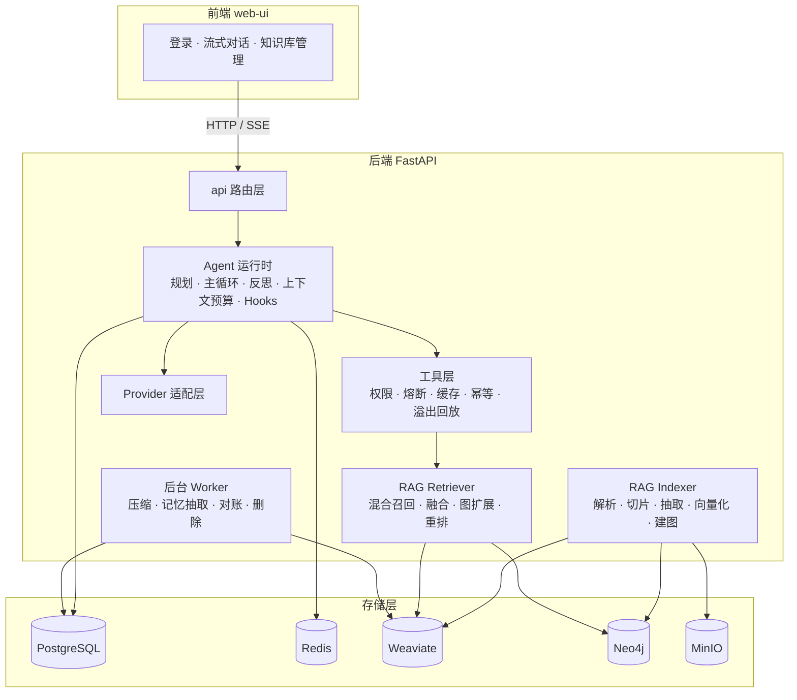

<div align="center">

# VerityAgent

**面向各种垂直领域的生产级 AI Agent + RAG 知识库问答系统**

多格式文档入库 · BM25 / 向量 / 图谱混合检索 · 多轮工具调用 · 三层记忆 · SSE 流式对话

[](https://www.python.org/)
[](https://fastapi.tiangolo.com/)
[](https://vuejs.org/)
[](https://nodejs.org/)
[](LICENSE)
[](#)

</div>

---

## ✨ 特性

### 🤖 规划-反思 Agent

- **先规划、再作答**：`QueryPlan` 判定是否检索、改写 query、抽取检索实体，规则短路无需检索的请求；主循环按轮反思，在继续 / 调整 / 止损间决策。
- **预算化上下文 + 工具闭环**：记忆、摘要、工作窗口、召回片段分来源按 token 预算拼装并留追溯；工具调用经权限过滤、熔断、缓存、幂等、大结果溢出与历史回放；SSE 凭会话租约和 `Last-Event-ID` 断线重连、可取消。

### 🧠 三层记忆 · 增量压缩

- **窗口 → 摘要 → 长期画像 / 事实**：工作窗口攒满即把旧批次压入 PG 会话摘要（CAS 乐观锁）；长期沉淀为 PG 七段画像 + Weaviate 原子事实（纯 BM25 按 query 召回）。
- **只落增量补丁**：LLM 产出画像补丁与新增事实，代码确定性 apply、乐观锁冲突重试；压缩、抽取、对账、删除均由后台 Worker 异步完成。

### 📚 章节切片 + 三路混合检索

- **章节树由粗到细**：按标题层级建树，整节未超 token 预算则整节打包、超限再下钻子标题；标题路径只入向量、不进正文；文本 / 列表 / 表格 / 代码分块独立，邻近短描述吸附归并。
- **BM25 + 向量 + 图谱三路召回**：RRF 融合后 rerank 重排，图谱邻居扩展；按文档批量补描述，观点冲突时双向扩邻居；入库即抽实体关系建图，领域画像约束类型、关系与别名。

## 🖼️ 界面预览

**对话页**：思考与执行过程、工具调用卡片、带引用的回答。



**知识库管理**：知识库与文档列表、入库状态、切片数 / Token 统计、上传与删除。



## 🧱 技术栈

| 层 | 选型 |
|---|---|
| 后端 | Python 3.12 · FastAPI · Uvicorn · Pydantic v2 · uv |
| 前端 | Vue 3.5 · TypeScript · Vite 8 · Pinia · Vue Router · Element Plus · Axios |
| 关系库 | PostgreSQL 17（psycopg 3 异步连接池） |
| 缓存 / 状态 | Redis 5（缓存、幂等、熔断、事件镜像、run 租约） |
| 向量检索 | Weaviate 4（`DocChunk` 向量 + BM25；`UserFact` 纯 BM25） |
| 知识图谱 | Neo4j 5 |
| 对象存储 | MinIO（知识库对象 / 会话临时对象） |
| 模型 | LLM：OpenAI 兼容 / Anthropic；Embedding：OpenAI 兼容；Rerank：Cohere / DashScope |

## 🏗️ 架构



## 🚀 快速开始

### 前置要求

- Python ≥ 3.12，包管理器 [uv](https://docs.astral.sh/uv/)
- Node.js `^22.18.0 || >=24.12.0`，包管理器 pnpm
- PostgreSQL 17、Redis、Weaviate 4、Neo4j 5、MinIO（可用 Compose 一键启动，见下）
- 至少一个 LLM / Embedding / Rerank 模型的 API Key

### 1. 启动基础设施

```sh
docker compose -f read/docker-compose.yml --env-file .env up -d
```

> Compose 文件位于 `read/`，需显式 `--env-file .env` 读取根目录 `.env` 中的 `PG__* / REDIS__* / NEO4J__* / MINIO__*`；不传也能用文件内默认值启动。

### 2. 配置环境变量

```sh
cp .env.example .env
```

至少修改：

- `DEEPSEEK_API_KEY` / `QWEN_API_KEY`：模型 API Key
- 数据库、Redis、Neo4j、MinIO、Weaviate 连接信息（默认值与 Compose 对齐，可本地直接启动）

### 3. 配置模型

模型清单在 [`verity-agent/config/models.json`](verity-agent/config/models.json)，密钥通过 `api_key_env` 引用 `.env` 中的变量。仓库已内置一套示例配置：

| 模型 id | 用途 | Provider | 密钥变量 |
|---|---|---|---|
| `chat-main` / `chat-no-thinking` | 对话 / 工具调用 / 入库描述与图抽取 | OpenAI 兼容（DeepSeek） | `DEEPSEEK_API_KEY` |
| `embed-default` | 文本向量化（1024 维） | OpenAI 兼容（Qwen） | `QWEN_API_KEY` |
| `rerank-default` | 召回重排序 | DashScope（Qwen） | `QWEN_API_KEY` |

按实际可用的模型修改 `model` / `base_url` / 维度等字段即可；字段口径见 `config/models.example.jsonc`。

### 4. 安装后端依赖

```sh
# 基础依赖
uv sync

# 按需安装文档解析 extras
uv sync --extra parsers      # PDF / DOCX / XLSX 常规解析
uv sync --extra ocr-light    # 轻量 OCR（RapidOCR / ONNXRuntime）
uv sync --extra ocr          # PaddleOCR（体积较大）
uv sync --extra layout       # MinerU 扫描 PDF 版式解析
```

### 5. 环境自检（可选）

`init.py` 会按 **PostgreSQL → Redis → Neo4j → MinIO → Weaviate** 顺序逐个探测连通性，并补齐缺失的表 / 约束 / bucket / collection（幂等，不删除业务数据）。单个服务失败不阻断其余服务，最终汇总 `OK / FAIL / SKIP`。

```sh
# 全量初始化 + 读写探针
uv run python init.py

# 只检查指定服务
uv run python init.py --only pg redis

# Weaviate 只校验 schema，不创建缺失 collection
uv run python init.py --weaviate-check-only
```

> 即使不单独运行 `init.py`，后端启动时也会执行同一套 `ensure_initialized()` 幂等初始化；可选服务连接失败按各自 `REQUIRED_FOR_STARTUP` 决定 fail-fast 还是降级启动。

### 6. 启动后端

```sh
uv run python main.py
```

- 地址：`http://localhost:8000`，API 前缀 `/api/v1`
- 健康检查：`GET /api/v1/health`、`GET /api/v1/ready`

> 开发 / 测试环境会自动写入种子账号：`xiaoxin / 123456`（管理员）、`xiaobai / 123456`（只读用户）；生产环境不自动改表。

### 7. 启动前端

```sh
cd web-ui
pnpm install
pnpm dev
```

默认 `http://localhost:5173`，`/api` 代理到 `http://127.0.0.1:8000`（需先启动后端）。

## ⚙️ 配置说明

配置边界：**env 只放运行环境、连接信息、密钥与部署差异**；业务默认值在 `config/*.py`，结构化策略在 JSON 配置，env 仅按需覆盖。

| 配置 | 位置 | 说明 |
|---|---|---|
| 应用 / 服务 / 日志 | `.env` → `config/app.py` | 环境、端口、热重载、CORS、日志分级与轮转 |
| 基础设施 | `.env` → `config/infrastructure.py` | PG、Redis、MinIO、Weaviate、Neo4j 连接与池化 |
| 认证 | `.env` → `AuthConfig` | JWT 算法、有效期、issuer / audience |
| 模型清单 | `config/models.json` | Provider、base_url、能力、定价、默认参数 |
| 工具策略 | `config/tools/policies.default.json` | 工具暴露条件、权限码、副作用与策略 |
| 领域画像 | `config/domains/*.json` | 实体 / 关系白黑名单、别名、抽取提示词；主画像 + 子画像自动合并 |
| RAG / 记忆 / Agent | `config/rag.py`、`config/memory.py`、`config/agent.py` | 入库切片、检索召回、记忆开关、Agent 运行参数 |

## 📁 目录结构

```text
VerityAgent/
├── main.py                 # 后端启动入口
├── init.py                 # 环境自检 / 初始化入口
├── pyproject.toml          # 依赖、extras、pytest / ruff 配置
├── .env.example            # 环境变量模板
├── verity-agent/           # 后端源码根
│   ├── api/                # FastAPI 应用、生命周期、中间件、路由
│   ├── agent/              # 运行时、规划、上下文、消息、Hooks、工具、Worker、适配器
│   ├── rag/                # Indexer（解析/切片/抽取/入库）与 Retriever（混合检索/重排）
│   ├── provider/           # LLM / Embedding / Reranker 工厂与适配
│   ├── store/              # pg / redis / weaviate / neo4j / minio 连接与仓储
│   ├── config/             # pydantic 配置、模型清单、工具策略、领域画像
│   ├── prompt/             # Prompt 注册表与模板
│   ├── exception/          # 分层异常与全局处理器
│   └── utils/              # 文本、token、ID、哈希、分页等通用工具
├── web-ui/                 # 前端（Vue 3 + TS + Vite）
├── tests/                  # 测试脚本、语料与产物（见 tests/README.md）；test-data/ 为知识库参考文档
├── read/                   # Compose、数据库 / 向量库 schema SQL 与 JSON、待上传的示例文档
└── images/                 # README 截图
```

## 📚 文档

- [`read/`](read/)：`docker-compose.yml` 基础设施编排、PostgreSQL 建表 / 迁移脚本、Weaviate schema 导入文件，以及待上传知识库的示例文档。
- [`tests/README.md`](tests/README.md)：测试与独立脚本说明、集成测试运行顺序。
- [`tests/test-data/`](tests/test-data/)：构建知识库的参考文档（Markdown 疾病 / 兽药分册 + 中英文 PDF 病例报告、规范与指南）。

## 🧪 测试

```sh
# 离线用例（不连外部服务、不产生 LLM 成本）
uv run pytest

# 集成用例（需真实基础设施，命令行显式打开 RAG_REAL_* 开关）
uv run pytest -m integration -s
```

详见 [`tests/README.md`](tests/README.md)。

## 📄 许可证

本项目基于 [MIT 许可证](LICENSE) 开源，© 2026 VerityAgent Contributors。
