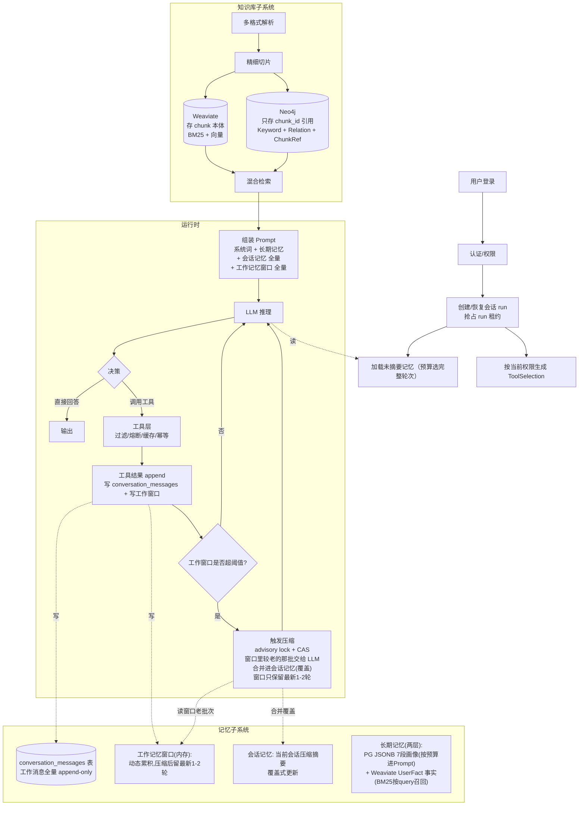
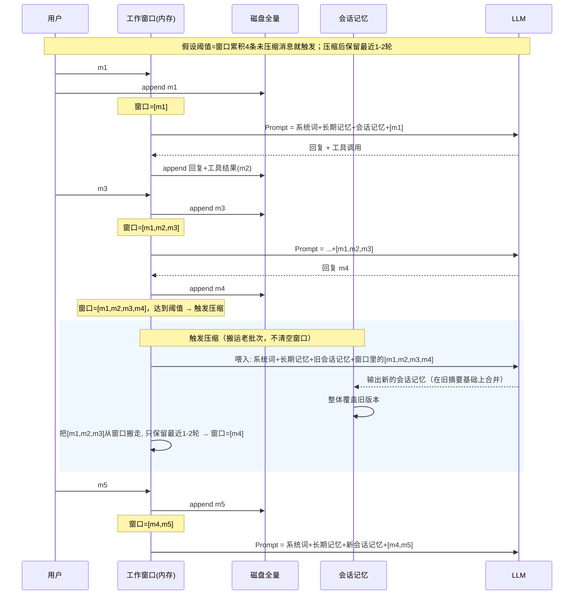
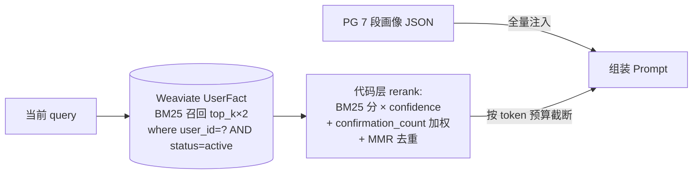
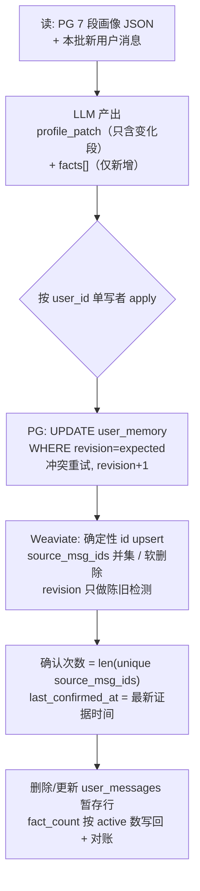
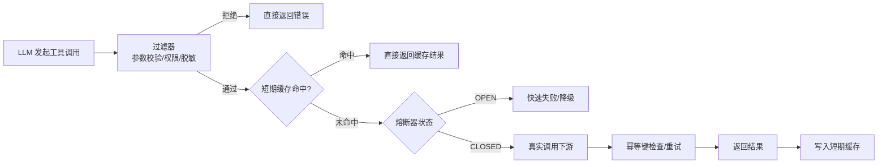
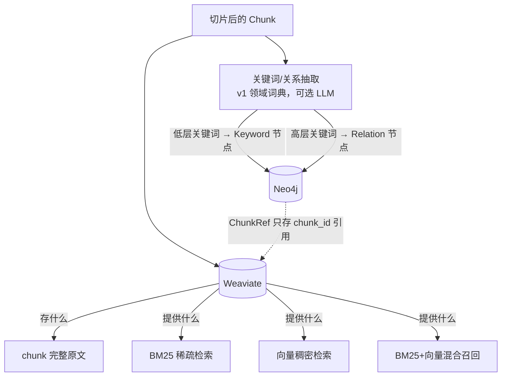
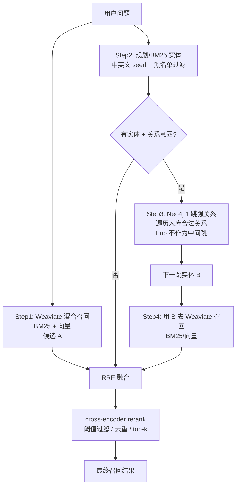

<!-- @format -->

# Agent + RAG 系统设计方案

> 本文档基于已梳理的开发思路整理而成，覆盖：用户登录与权限、三层记忆体系、工具模块（含路由优化）、多格式切片、三模混合知识库（BM25 + 向量 + 图）。
>
> **v3 修订要点**：重新厘清 §2 记忆模型——
>
> - **工作记忆是动态滑动窗口**：从最新消息开始累积，攒到阈值才触发压缩；
> - **压缩不是清空窗口，而是把窗口里较老的那批搬进会话记忆**，窗口保留 0/1/2 轮当缓冲（按窗口轮数和最近回合长度动态判断）；
> - **进 Prompt 时工作记忆按 token 预算装入最新完整轮次**，和会话记忆是配合关系：会话记忆管"历史结论"，工作记忆管"刚发生的细节"；
> - 末尾附录 A 保留并更新评审。
>
> **v4 修订要点（§2.4 长期记忆，已被 v5 取代）**：曾设计为"PG 摘要 + 一事实一 `.md` 文件 + Weaviate 派生索引"三层，v5 废弃文件方案。
>
> **v5 修订要点（§2.4 长期记忆定稿）**：长期记忆收敛为**两层**——
>
> - **PG `user_memory.value`（JSONB）**：用户画像 7 段（现在时 4 段 + 过去时 3 桶），小，按上下文预算进入 Prompt；乐观锁 `revision` 是表独立列；
> - **Weaviate `UserFact` collection**：原子事实，只走内置 BM25（不挂向量、不建图），按当前 query 召回；
> - 废弃 `.md` 文件、manifest、journal；事实直接存 Weaviate，单企业单 Agent 够用；
> - LLM 只产增量结果：`profile_patch`（仅变化段，覆盖式）+ 新增 `facts[]`；代码确定性 apply，乐观锁冲突重试。`change_set`（to_add/to_update/to_deprecate/summary_patch）是后续目标契约。
>
> **v6 修订要点（2026-11-08，总览/主设计/治理块已拍）**：
>
> - `ConversationRuntime` 由 `AgentRun + AgentTurn` 取代；消息 `Turn` 只作投影（D-21）；
> - 保留回合数动态 0/1/2（D-31）；
> - RAG 公共面为 `Indexer + Retriever`（D-52）；
> - **v1 必须实现图检索**；入库阶段始终建图；检索扩展 `graph_expansion_enabled`（D-55 默认关闭，当前部署开启）可按 KB 开关；`documents.completed` 始终要求 Neo4j（D-55/D-56）；
> - §4.3.1 与 §4.3.3 对齐：**v1 不启用代码 AST**，Markdown 围栏代码按行/逻辑块切分，tree-sitter 移至后续；`DocChunk.heading` 存最近一级标题，`DocChunk.heading_path`（text[]）存完整章节路径（D-76，2026-11-13 调整）；
> - 新增《API 与流式契约》《后台任务与 Worker 设计》《认证与权限设计》（D-89/D-90/D-91）；
> - 所有 config/setting 由 `config` 包统一管理，业务模块只消费配置；`setting.py` 已移除，统一使用 `config` 包（D-92）；
> - 统一 `knowledge_bases.index_version`、`user_memory.facts_revision`；存储 UTC、展示本地（D-54/D-50/D-60）；
> - 画像按 `user_memory.revision` 懒加载，run 内不重载（D-102）；
> - RAG 检索后按 unique `doc_id` 批量补文档描述，chunk 不挂描述，按 doc 分组注入（D-103）；
> - 测试/验收下一阶段再做（D-93）。

---

## 0. 总体架构总览



**核心数据流一句话总结**：
run 开始时把"用户态 + 记忆 + 工具"装进运行态 → 每轮对话把"长期记忆 + 会话记忆 + 工作窗口"全量拼进 Prompt → LLM 决策调工具 → 工具结果同时写 `conversation_messages` 表（全量落盘）和工作窗口 → 工作窗口攒够阈值就把老批次压缩进会话记忆、窗口留最新 1-2 轮 → 后台异步再从全量消息里抽长期记忆。

> **"磁盘全量"就是 PG `conversation_messages` 表**（按 `seq_no` 递增、`content JSONB`），不再单独维护 JSONL/SQLite 文件；它是压缩、长期记忆抽取、**对话内容**审计的 ground truth；完整 Prompt/ContextPlan 审计由日志系统的 `PromptLogRecord` 记录。

---

## 1. 用户登录与权限模块

### 1.1 设计目标

- 登录后**用户身份/权限**可缓存（常驻内存或短 TTL），避免每轮重复查库；**会话记忆不常驻**，按 run 加载。
- 记忆加载分两种会话形态：**新会话** vs **历史会话**。
- 工具不是全量暴露，而是按用户权限**过滤后再注册**，避免越权调用与 token 浪费。

### 1.2 登录态与运行态（伪代码）

登录态只放“用户是谁、能做什么”，不把某个会话的记忆常驻内存；记忆按 run 加载，内存态不是权威。

```python
@dataclass
class UserSessionState:            # 登录态：认证/权限，跨会话复用
    user_id: str
    username: str
    roles: list[str]                # ["admin", "developer", "viewer"]
    permissions: set[str]           # 细粒度权限码，如 {"kb:read:public", "tool:sql:read"}


@dataclass
class ConversationRuntime:        # 已废弃：由 AgentRun + AgentTurn 取代（D-21），仅保留历史说明
    conversation_id: str
    run_id: str
    lease_expires_at: datetime | None

    # —— 下面这些在 run 开始时按策略从 PG/Weaviate 加载 ——
    long_term_memory: dict          # 长期画像 + 按 query 召回的事实
    session_memory: dict | None     # 会话摘要（历史会话加载；新会话 None）
    working_window: list[Message]   # 水位线之后的未摘要消息，按安全上限/预算选完整回合（见 §2.2）
    registered_tools: list[Tool]    # 按权限过滤后真正暴露给 LLM 的工具
```

- `UserSessionState` 不持有 `long_term_memory / session_memory / working_window`，避免登录态和会话运行态混在一起；
- `ConversationRuntime` 在每次 run 开始时重建；多进程/多实例下不依赖“登录后常驻内存”；
- run 通过 `conversations.current_run_id + lock_expires_at` 租约串行化（见 §1.4）。

> **2026-11-08 修订（D-21）**：`ConversationRuntime` 已由《Agent 模块数据结构设计》的 `AgentRun + AgentTurn + AgentContextSnapshot` 取代；`UserSessionState` 归《认证与权限设计》。上面的 `ConversationRuntime` 仅保留为历史说明，不再作为实现模型。消息文档的 `Turn` 也只作为只读投影，运行态统一用 `AgentTurn`。

### 1.3 记忆加载策略

| 会话类型     | 长期记忆 | 会话记忆            | 工作记忆窗口                                                | 磁盘工作记忆         |
| ------------ | -------- | ------------------- | ----------------------------------------------------------- | -------------------- |
| **新会话**   | ✅ 加载  | ❌ None             | ❌ 空列表                                                   | 空（本次会话刚开始） |
| **历史会话** | ✅ 加载  | ✅ 加载（压缩摘要） | ✅ 加载 `seq_no > covered_through_seq` 的未摘要消息（单次有安全上限） | ✅ 全量在盘          |

**关键点**：

- 磁盘上永远保留**全量工作记忆**，是压缩、长期记忆抽取、对话内容审计的 ground truth；完整 Prompt/ContextPlan 由审计日志记录。
- 历史会话恢复时，**不是只取最近 1-2 轮**：加载水位线之后的未摘要消息并按完整回合组织；单次加载先受 `AGENT__HISTORY_LIMIT` 安全上限约束，再由 `ContextBudgetPlanner` 按 token 预算从最新完整回合向前装入。超限时按“最老的完整回合”确定性丢弃并记 warning，不能按固定条数从轮次中间截断。
- “压缩后保留最近 1-2 轮”只描述**压缩后窗口的缓冲区**，不是历史加载规则。
- 记忆在每次 run 开始时加载，运行期只做增量更新；不假设登录后常驻内存。

### 1.4 会话 run 租约

- `conversations` 增加 `current_run_id / run_started_at / lock_expires_at`；
- 启动 run 时用条件更新抢占租约（`current_run_id IS NULL OR lock_expires_at < now()`），拿不到返回 409/排队；
- run 期间 heartbeat 续租；结束/失败/取消释放；崩溃后租约过期可被新 run 接管；
- 同一会话同一时刻只允许一个 run，避免双击/多标签页/客户端重试导致消息、工具链、压缩交错。

### 1.5 工具权限过滤与注册

```
所有可用工具全集 ToolRegistry（代码里静态注册）
        │
        ▼
按 user.permissions 过滤
   tool.required_permission ∈ user.permissions ?
        │
        ▼
注入到当前 LLM 实例的 tools 字段
```

- 工具元信息里声明自己需要的权限码，例如 `calculator_sql.required_permission = "tool:sql:read"`。
- 没权限的工具**根本不出现在 LLM 的工具列表里**，连描述都看不到——这是最安全、最省 token 的做法。
- 权限过滤在**每次 run 开始**时按当前权限做一次（`ToolSelection`）；运行期如果权限变更，需要提供"热重载用户态"接口，且每个敏感工具调用时再做一次二次校验（见 §3.1.1）。

**权限码口径（暂不引入复杂权限结构）**：

- `permission_code` 是通用的命名空间字符串，程序不解析其结构；同一个 `permissions` / `user_permissions` 表可以授权：
  - 工具能力：`tool:sql:read`
  - 数据库：`db:finance:read`
  - 具体知识库：`kb:read:<kb_id>`
  - 具体文档：`doc:read:<doc_id>`
- `knowledge_bases.required_permission_code` 存**具体的资源权限码**（如 `kb:read:kb_001`）；检索/读取时检查用户是否拥有该码。
- `ToolSpec.required_permission` 放静态能力码（如 `tool:kb:search`），用于工具暴露；`ToolSpec.resource_permission_template` 放资源模板（如 `kb:read:{kb_id}`），执行时按参数解析并逐项检查 `ToolContext.permissions`。
- 多资源工具（如 `search_kb(kb_ids=[...])`）逐 KB 检查：无权限的 KB 过滤掉并 warning；全部无权限才 `PERMISSION_DENIED`。
- `RAG INJECTED` 模式同样按 `kb_id` 的权限码过滤，不能只靠工具层。
- 不新增 ACL 表/资源授权服务；继续用 `permissions` + `user_permissions` 的权限码表达资源级授权。

---

## 2. 记忆模块（三层记忆体系）

### 2.1 三层记忆对照表（v3 正确版）

| 维度              | 工作记忆 Working Window                                                                    | 会话记忆 Session Memory                           | 长期记忆 Long-term Memory                                            |
| ----------------- | ------------------------------------------------------------------------------------------ | ------------------------------------------------- | -------------------------------------------------------------------- |
| **是什么**        | **当前还没被压缩的原始消息流**：用户提问、LLM 思考、工具调用、工具返回、LLM 回答           | 当前会话**已经被压缩过**的部分，整理成结构化摘要  | 跨会话沉淀的用户画像与稳定事实                                       |
| **磁盘上**        | ✅ 全量 append-only 落盘，一条不丢                                                         | ✅ 每会话一条记录                                 | ✅ 独立持久化                                                        |
| **内存里**        | ✅ 动态窗口：从最新一条开始累积，压缩后只留最新 1-2 轮                                     | ✅ 全量加载                                       | ✅ 全量加载                                                          |
| **是否进 Prompt** | ✅ 按 token 预算装入最新完整轮次；当前用户回合必含                                     | ✅ 按预算截断后进入                                         | ✅ 摘要层按预算进入；事实层按当前 query 走 BM25 召回（见 §2.4.4/§2.4.5） |
| **生命周期**      | 跟会话同生共死                                                                             | 一个会话只保留一份                                | 永久保留                                                             |
| **更新触发**      | 每轮对话 append（写盘 + 写窗口）                                                           | **每次工作窗口触发压缩时，合并覆盖更新**          | 后台异步分批扫描                                                     |
| **更新策略**      | 追加 append；压缩时把老批次搬走、按策略保留 0/1/2 轮                                       | **覆盖 overwrite**（在旧摘要基础上 merge 新批次） | **增量 upsert**                                                      |
| **和谁配合**      | 与会话记忆互补：会话记忆讲"之前聊到哪、结论是啥"，工作记忆讲"刚刚这几步工具调用的原始细节" | 接收工作窗口搬来的老批次                          | 独立于单次会话                                                       |

> **关键心智模型**：工作记忆和会话记忆不是"新旧替代"关系，而是"**细节 vs 摘要**"的配合关系。压缩只是把工作窗口里已经足够稳定的老批次"搬家"到会话记忆里整理成摘要，工作窗口本身继续承担最近几轮的原始细节。

### 2.2 工作记忆：动态滑动窗口 + 磁盘全量

#### 2.2.1 一条消息的结构

```json
{
	"role": "user | assistant | tool | system",
	"status": "streaming | completed | partial | failed",
	"content": "...",
	"images": [{ "url": "/media/{file_id}", "detail": "auto" }],
	"files": [{ "file_id": "uuid", "filename": "report.pdf" }],
	"tool_calls": [
		{
			"call_id": "call_xxx",
			"name": "search_kb",
			"arguments": {},
			"status": "pending"
		}
	],
	"tool_call_id": "call_xxx",
	"created_at": "2026-10-28T10:00:00Z"
}
```

> 具体字段以《消息数据模型设计》§9.2 的 v2 content 为准；这里只是窗口条目的示意。

#### 2.2.2 时间轴上的窗口演变（核心）

> 窗口定义：`seq_no > covered_through_seq` 的未摘要消息。历史会话首次加载先取其中最近的 `AGENT__HISTORY_LIMIT` 条（安全上限），再由 `ContextBudgetPlanner` 按 token 预算选完整回合；“压缩后保留 0/1/2 轮”只是压缩后的缓冲区。下面的 4 条阈值只用于演示压缩触发，不是加载时的截断规则。

假设压缩阈值 = 窗口累积 4 条消息就触发，压缩后保留最近 1-2 轮：

```
时间线 →

磁盘（永久全量）:
  [m1][m2][m3][m4][m5][m6][m7][m8][m9][m10]...

工作窗口(内存) 演变:
  初始:  []
  m1 →   [m1]
  m2 →   [m1, m2]
  m3 →   [m1, m2, m3]
  m4 →   [m1, m2, m3, m4]   ← 攒够 4 条，触发压缩
          │
          │ 把 [m1,m2,m3] 喂给 LLM，合并进会话记忆
          │ 窗口只保留最近 1-2 轮 → [m4]
          ▼
  m5 →   [m4, m5]
  m6 →   [m4, m5, m6]
  m7 →   [m4, m5, m6, m7]   ← 再次触发压缩
          │ 把 [m4,m5,m6] 合并进会话记忆
          │ 窗口保留 → [m7]
          ▼
  ...
```

#### 2.2.3 进 Prompt 时的拼装

```
Prompt = [系统提示词]
       + [长期画像（按预算截断）]
       + [会话摘要（按预算截断）]
       + [按 token 预算从新到旧选择的最新完整轮次]
```

- **工作窗口按 token 预算选完整轮次，不按固定条数**：`ContextBudgetPlanner` 先扣 system / RAG / 摘要 / 画像 / 工具 schema，再从最新完整回合向前装入；当前用户回合始终保留。
- 之所以窗口通常较小，是因为压缩阈值一到就把老批次搬走；预算规划只是总上下文的安全阀，不替代压缩。
- 历史会话首次加载时先取水位线之后**最近**的 `AGENT__HISTORY_LIMIT` 条（安全上限），再由预算选择完整回合；超过上限时按最老完整回合确定性丢弃并记 warning，不能从轮次中间截断。
- 会话记忆和工作窗口加在一起，才构成 LLM 能看到的"完整对话上下文"：摘要 + 最近细节。

#### 2.2.4 为什么这样设计

- **磁盘全量**：不丢任何原始上下文，是压缩、长期记忆抽取、对话内容审计的 ground truth；完整 Prompt 由审计日志记录。
- **窗口动态累积**：让 LLM 在一个"任务回合"内能看到完整的工具调用链（用户提问 → 工具 A 返回 → 工具 B 返回 → LLM 回答），不会被中途裁剪。
- **压缩后保留 0/1/2 轮**：按窗口轮数和最近回合长度动态判断，作为"缓冲带"；不是固定保留 1-2 轮。
- **超限不静默丢**：未摘要消息超过加载安全上限时，先压缩；压缩不可用则按最老完整回合确定性丢弃并记审计事件，不能按固定条数从轮次中间截断。

### 2.3 会话记忆：每次压缩时合并覆盖

#### 2.3.1 压缩-滑动循环



#### 2.3.2 压缩输入

每次压缩时，把整份上下文喂给 LLM：

```
[系统提示词]
[长期记忆摘要]
[当前已有的会话记忆（上一版压缩结果）]
[本次窗口里累积的全部消息（要被搬走压缩的那批 + 最新 1-2 轮）]
```

> 设计意图：让 LLM 在"知道用户是谁、知道这个会话之前已经总结过什么"的前提下，把窗口里这一整批新消息**merge 进**已有的会话记忆，输出一份最新版摘要。

#### 2.3.3 输出格式（强制结构化）

摘要 JSON 分三层：**话题**是按聊天主题的归类，**事实**和**约束**是独立的顶层数组，不嵌在话题里。

```json
{
	"version": 3,
	"topics": [
		{
			"id": "uuid（新主题可省略）",
			"name": "Weaviate 混合检索选型",
			"summary": "对比了 Weaviate / Qdrant / OpenSearch 在 BM25+向量混合检索上的差异，初步选定 Weaviate。",
			"source_round_ids": ["本轮新增 round uuid"]
		}
	],
	"facts": [
		{
			"fact_id": "uuid（新事实可省略）",
			"content": "用户目前自用 iQOO Neo11，开发机是 Windows",
			"topic_id": "uuid",
			"source_msg_ids": ["本轮新增 msg id"],
			"confidence": 0.9
		}
	],
	"constraints": [
		{
			"constraint_id": "uuid（新约束可省略）",
			"content": "向量库必须原生支持 BM25 与向量的混合排序",
			"source_msg_ids": ["本轮新增 msg id"],
			"confidence": 0.85
		}
	]
}
```

**强制字段说明**：

- 模型只输出**本次修改或新增**的条目；未出现的旧 topic/fact/constraint 原样保留，不要求重复输出。
- `topics[]`：`id` 主题 id、`name`、`summary`、本轮新增的 `source_round_ids`。`mention_count`/`last_mentioned_at` 由代码维护：按新增轮次数增加讨论次数，并写本次压缩时间。
- `facts[]`：`fact_id`（已有事实必须沿用）、`content`、可选 `topic_id`、本轮新增 `source_msg_ids`、`confidence`。`confirmation_count`/`last_confirmed_at` 由代码维护：同内容确认时增加，内容改写/冲突覆盖时重置为 1。
- `constraints[]`：字段同 facts，但不含 `topic_id`。
- 事实/约束独立于话题：一条事实可能跨多个话题出现，不嵌在某个 topic 里。
- 摘要 facts 超过 `MEMORY__COMPRESSION_MAX_FACTS`（默认 50）时，按确认少、最旧、低置信度淘汰。

#### 2.3.4 触发时机与并发

- **按"窗口累积量"触发**：当工作窗口里未压缩消息累计超过阈值（token 数或条数）就触发。
- 压缩前先拿**会话级 advisory lock**（`pg_try_advisory_lock(hashtextextended(conversation_id::text, 0))`）；拿不到就跳过本轮，不阻塞用户回复。
- 写摘要时用 `covered_through_seq = $expected` 做 **CAS**；0 行说明已被其他压缩推进，**不覆盖、不推进、不复用旧 LLM 输出**，重读后重算或等下一轮。
- **压缩失败分类**：
  - 网络/超时/限流/上游 5xx：少量重试（约 2 次）+ 退避；
  - 请求丢失（已发出无响应）：换新 `request_id` 再试 1~2 次；
  - 鉴权/配额/非法请求/内容拦截：不重试，保留旧摘要，给用户“服务不可用”提示；
  - 输出非法：按《记忆模块数据结构设计》§8.5 修复一次，仍失败则保留旧摘要；
  - 失败时**不推进水位线**，旧摘要 + 全部未摘要消息都在，下一轮可重试；
  - 窗口已达 `hard_max_tokens` 仍失败：按最老完整回合确定性丢弃并告警（`DEGRADED`），不能无限增长。
- 压缩完成后：
  - 会话记忆按增量 apply：代码把模型返回的 topic/fact/constraint upsert 到旧摘要，并维护讨论次数、确认次数与时间；
  - 窗口里**较老的那批**从内存窗口移除；
  - **保留轮数动态判断**（0/1/2，见《记忆模块数据结构设计》§4.3）：
    - 窗口完整回合 <3：不保留；
    - 3~4 回合：最近 1 回合长度合适则保留 1，否则 0；
    - ≥5 回合：最近 2 回合长度合适则保留 2，否则 1/0；
- **topic 遗忘**（同一份记忆文档 §5.3.1）：
  - `compression_count > 5` 且 `topics > 10` 时启用；
  - 按 `mention_count`、`last_mentioned_at` 识别“插话”；
  - **最新 topic 永不删除**；
  - 一次最多遗忘 `max_forget_per_compression` 条。
- **摘要 facts 上限**：超过 `MEMORY__COMPRESSION_MAX_FACTS`（默认 50）时，按确认次数少、`last_confirmed_at` 最旧、置信度低淘汰；长期 `UserFact` 另受 `MEMORY__FACT_MAX_ACTIVE`（默认 150）约束。
- 这样窗口在压缩后维持在"小而新鲜"的状态，进 Prompt 的工作记忆 token 可控；历史会话首次加载先取水位线之后最近的 `AGENT__HISTORY_LIMIT` 条，再按预算选择完整回合，超限时先压缩或按完整回合丢弃并告警。

### 2.4 长期记忆（Long-term Memory）—— PG 画像 + Weaviate 事实，后台增量抽取

> v5 修正：废弃 v4 的"一事实一 `.md` 文件 + manifest + journal"文件方案，改为两层——画像存 PG JSONB（7 段），原子事实存 Weaviate `UserFact`（只走 BM25）。字段细节见《记忆模块数据结构设计》。

#### 2.4.1 两层存储，而不是一个大 JSON

| 层         | 介质                            | 存什么                                          | 进 Prompt 方式                   |
| ---------- | ------------------------------- | ----------------------------------------------- | -------------------------------- |
| **摘要层** | PG `user_memory.value`（JSONB） | 用户画像：现在时 4 段 + 过去时 3 段（见 2.4.2） | **全量注入**（小，常驻认知）     |
| **事实层** | Weaviate `UserFact` collection  | 一条条原子事实（工作/偏好/约束/目标）           | 按当前 query **BM25 召回 top-k** |

- 摘要层是 condensed self，每轮按预算进入系统提示词；事实层按 query 召回，不全量进；
- 事实直接存 Weaviate，不再落 `.md` 文件——单企业单 Agent，Weaviate 即事实权威存储；
- `UserFact` 和知识库 chunk 是两个独立 collection（`UserFact` vs `DocChunk`），按 `user_id` 过滤，不混池。

#### 2.4.2 PG 摘要层结构（`user_memory.value`）

```json
{
	"lastUpdated": "2026-10-29T10:00:00Z",
	"user": {
		"workContext": { "summary": "...", "updatedAt": "...", "confidence": 0.8 },
		"personalContext": {
			"summary": "...",
			"updatedAt": "...",
			"confidence": 0.8
		},
		"topOfMind": { "summary": "...", "updatedAt": "...", "confidence": 0.8 },
		"cognitiveStyle": {
			"summary": "...",
			"updatedAt": "...",
			"confidence": 0.8
		}
	},
	"history": {
		"recentMonths": { "summary": "...", "updatedAt": "...", "confidence": 0.7 },
		"earlierContext": {
			"summary": "...",
			"updatedAt": "...",
			"confidence": 0.7
		},
		"longTermBackground": {
			"summary": "...",
			"updatedAt": "...",
			"confidence": 0.7
		}
	}
}
```

- `user.*` 现在时 4 段：工作/求职、个人背景、当前最关注、沟通认知偏好；
- `history.*` 过去时 3 桶：近 3 个月、更早阶段、长期底色；
- 每段自带 `updatedAt` 和 `confidence`，LLM 只动需要动的段，不整份重写；
- **画像保留来源**：每段除 `updatedAt + confidence` 外还带 `source_msg_ids`（本批用户消息 id，按上限保留最近证据）；与 chunk 冲突时由读路径 `resolve_chunk_conflict` 工具处理，不修改画像/事实正文，来源仍可回查；
- 乐观锁 `revision` 是 `user_memory` 表的独立列（不在 JSON 里），见《PostgreSQL 数据库结构设计》§2.9。

#### 2.4.3 Weaviate `UserFact` 字段

| 字段                        | 用途                                                          |
| --------------------------- | ------------------------------------------------------------- |
| `id` / `user_id`            | 事实主键（确定性 UUID）/ 租户过滤（查询必带 where）           |
| `revision`                  | 客户端并发标记；Weaviate 不提供 CAS，由按用户单写者做陈旧检测 |
| `content`                   | 事实正文，唯一 BM25 检索字段                                  |
| `category`                  | work / personal / preference / constraint / goal / history    |
| `confidence`                | 0~1 置信度，召回加权用                                        |
| `confirmation_count`        | 被对话反复确认次数；等于 `source_msg_ids` 去重后的数量        |
| `last_confirmed_at`         | 最近一次被确认时间                                            |
| `source_msg_ids`            | 证据/确认消息 id 列表（只存指针，不存正文）                   |
| `status` / `deprecated_at`  | `active / deprecated` + 软删除时间；淘汰不物理删除            |
| `created_at` / `updated_at` | 创建/更新时间                                                 |

只配内置 BM25：不启 vectorizer、不做 hybrid、不连 Neo4j 图。查询固定 `where user_id=? AND status=active`。

#### 2.4.4 运行时召回路径



- 摘要 JSON 按 token 预算进入；事实按 query BM25 召回，代码层加权排序后按 token 预算截断；
- `confirmation_count` 高、`last_confirmed_at` 近的事实加权更高。

#### 2.4.5 增量更新链路（LLM 产增量补丁，代码确定性 apply）

**LLM 不直接写 PG、也不直接写 Weaviate**，只输出“画像增量补丁 + 新增事实”，
由代码落盘：



- `profile_patch` 只包含**本次确有变化**的 7 段字段；每个字段给出该段更新
  后的完整摘要（覆盖式替换），未出现的段保持旧值。LLM 不再复制/重写整份
  画像，避免措辞漂移导致所有段反复刷新；
- `facts[]` 只包含本次新增的原子事实，不重写已有事实集；每条事实带
  `msg_id`，代码逐条 upsert；
- 给 LLM 的候选事实回喂与 `to_update / to_deprecate` 仍是目标契约，
  尚未落地（当前去重依赖确定性 id 与可选冲突判定）；
- PG 乐观锁走独立 `revision` 列：`UPDATE ... WHERE revision = $expected`，冲突重试；
- Weaviate 不提供 CAS：按 `user_id` 单写者串行化；事实 `revision` 只做“读-校验-写”的陈旧检测；
- 新增事实 id 由 `uuid5(user_id + normalized_content)` 确定性生成，**创建后保持稳定，内容更新不重新生成**；内容变更时以新证据覆盖 `source_msg_ids` 并重新计数；仅再次确认时把新消息 id 并入并重新计数，**不做盲目的 `confirmation_count++`**；
- 淘汰用 `status=deprecated` + `deprecated_at`，保留证据指针，不物理删除。

**事实冲突（P1-17）**：

- 冲突在抽取 Prompt 内一并判断，不再单独跑规则或第二个冲突 LLM；
- 抽取前用本批消息 BM25 回喂有限既有事实候选；模型只输出真实冲突：
  - `none`：无冲突，新增事实；
  - `override`：明确正反冲突，写新事实并 supersede 旧事实；
  - `merge`：同维度可合并，模型给出旧事实改写后的 `target_content`；代码写入新内容并 supersede 旧事实，确认次数重置为 1；
  - `partial_conflict`：旧事实部分被否定，模型给出旧事实改写后的 `target_content` 与新增部分 `content`；代码分别写入并 supersede 旧事实，确认次数重置为 1；
- 同义/相同事实不做冲突分类，靠确定性 id 幂等写入；
- 事实/画像与 chunk 冲突：**不改 chunk、不改事实/画像正文**；由 `resolve_chunk_conflict` 读路径工具结合文档时间、质量与邻居片段给出结论，画像/长期事实只作参考。

#### 2.4.6 后台分批扫描

```
后台 worker 独立协程/进程，不阻塞主对话：
  while True:
      先选一个 user_id，再领该用户 status IN ('pending','failed')
        AND ready_at IS NOT NULL AND next_retry_at <= now() 的消息
        （FOR UPDATE SKIP LOCKED，置 processing + locked_until/locked_by），每批约 20 条
      带上前后各 1~2 条助手/工具消息做语境
      读 PG 画像 JSON + 用本批消息 BM25 召回的候选事实 FactView（含 content）
      喂给便宜小模型（ChatService.complete, purpose=MEMORY_EXTRACTION），产出 change_set；
        按结构化输出策略解析/校验/修复一次，仍非法则整批 failed
      按 user_id 单写者 apply：成功 → 删除这批 user_messages 暂存行；
        失败 → attempt_count++ / next_retry_at 退避；超过上限 → dead
```

- **按用户分批**：一批只含一个 `user_id`，保证画像/事实 apply 目标唯一；两个 worker 不能同时 apply 同一用户；
- **回合终态才可抽取**：用户消息落库时 `ready_at` 为空；回合结束才置位，worker 不领取未完成回合，避免“再优化一下”缺少助手语境；
- **没有显式 offset/watermark**：靠 `user_messages` 状态机 + `ready_at` + `FOR UPDATE SKIP LOCKED` 领任务；重启后重扫 `pending/failed` 即可续跑；
- `processing` 有租约（`locked_until`），worker 崩溃后可被重新领取；
- 抽取/整理走小模型（qwen-turbo / gpt-4o-mini / 本地 7B，见 A.3.7），主对话走大模型。

---

## 3. 工具模块

### 3.1 工具的四类横切能力



#### 3.1.1 过滤器（Filter）

- 入口参数校验：必填项、类型、取值范围。
- 二次权限校验：即使 run 开始时过滤过，敏感工具（如写库、发邮件）调用时再校验一次当前用户是否还有权。
- 资源级权限：按工具参数解析具体资源码（如 `kb:read:<kb_id>` / `doc:read:<doc_id>` / `db:read:<db_name>`），逐项检查；多 KB 检索过滤未授权项并 warning。
- 敏感数据脱敏：工具入参里如果有手机号、身份证，先打码再日志。

#### 3.1.2 熔断器（Circuit Breaker）

- 每个工具维护一个状态机：`CLOSED（正常）→ OPEN（熔断，直接失败）→ HALF_OPEN（试探恢复）`。
- 触发条件：例如最近 10 次调用里失败率 > 50%，或平均耗时 > 阈值。
- 熔断后 LLM 收到的不是超时等待，而是一个**快速返回的结构化错误**，让它能立刻换工具或告知用户。

#### 3.1.3 幂等设计（Idempotency）

- 尽量把每个工具设计成幂等的：同样的入参调多少次，对外副作用一致。
- 写操作类工具（发邮件、建表）：要求 LLM 或调用方传一个 `idempotency_key`（通常由"用户 id + 业务语义 + 稳定参数哈希"生成），服务端记录这个 key，重复请求直接返回上次结果。
- 读操作天然幂等，不用额外处理。
- ⚠️ 幂等 key 计算时要**排除时间戳、随机种子、非确定性参数**，否则缓存永远不命中（见附录 A.3.9）。
- **v1 执行边界**：自动执行只允许 `READ`；`WRITE/DESTRUCTIVE` 必须 `requires_confirmation + idempotency=REQUIRED + supports_reconcile`，否则不自动执行。
- 写工具崩溃/请求丢失后 `IN_PROGRESS` 过期按 `UNKNOWN` 处理：先用 `idempotency_key` 对账，确认未执行且工具幂等才重试；不能盲目重试。

#### 3.1.4 短期缓存

- 缓存 key = `hash(工具名 + 规范化后的入参 JSON)`。
- 命中直接返回，不再打下游。
- TTL 按工具语义设置：
  - 查知识库、查天气：TTL 可以几分钟到几小时；
  - 查实时行情：TTL 几秒；
  - 写操作：不缓存。
- 缓存写 Redis（工具缓存 key 见《工具模块数据结构设计》§8.2），不使用进程内 LRU 作为默认；容量由 Redis `maxmemory`/淘汰策略控制。

### 3.2 后期优化：工具路由（Tool Router）

#### 3.2.1 要解决的问题

工具数量上去后（几十上百个），全部塞进 LLM 的 tools 描述里：

- **注意力稀释**：LLM 在一大堆工具里挑不准；
- **token 成本爆炸**：每轮请求都要把所有工具描述重发一遍。

#### 3.2.2 路由设计（路由本身也是一个工具）

```
一开始暴露给 LLM 的不是具体工具，而是"路由工具"：
  ├── router_dev      → 描述"开发类工具组"，列组内每个工具的一句话简介
  ├── router_data     → 描述"数据查询类工具组"
  ├── router_kb       → 描述"知识库类工具组"
  └── router_misc     → 描述"其他工具组"
```

**动态注册机制**：

1. 第一轮：LLM 只看到 N 个路由工具。
2. LLM 决定调用 `router_kb`（相当于说"我要看知识库相关工具"）。
3. 系统响应：
   - **把 `router_kb` 这个工具从本轮 tools 里移除**；
   - **把 router_kb 下面挂的所有真实工具注册进来**；
   - 其他路由工具暂时保留（也可以移除，按 token 预算权衡）。
4. LLM 在缩小后的工具集里继续决策。

#### 3.2.3 成本与复杂度权衡

- **工具 < 15 个**：不要做路由，直接全量暴露。路由本身也有一跳 LLM 调用成本。
- **工具 15~30 个**：可以做一级路由。
- **工具 > 30 个**：考虑多级路由（组下面再有子组）。
- 路由工具的描述要写得非常"判别友好"，让 LLM 一眼就知道该进哪个组。

---

## 4. 切片模块（Chunking）

### 4.1 核心原则

**不同文件格式用不同解析器；同一文件内不同文本类型用不同切片策略。** 不能一份 recursive_character_text_splitter 打天下。

### 4.2 多格式解析层

> **v1 实现范围**：只启用 `.pdf / .docx / .md / .txt / .xlsx`。表格统一转成纯文本行进入 chunk；PDF/DOCX 内的普通图片不进入 chunk；纯图片/扫描 PDF 走 MinerU/RapidOCR 版式解析（见《PDF 纯图片解析链路》）；PPTX/HTML/CSV/代码文件/图片 OCR parser 后续版本接入。

| 文件类型                     | 解析器                              | 切片特点                                 |
| ---------------------------- | ----------------------------------- | ---------------------------------------- |
| `.txt / .md`                 | 纯文本 / Markdown AST               | 按标题层级递归切，保留标题路径           |
| `.pdf`                       | PDF 解析（pdfplumber / PyMuPDF）    | 区分正文栏、页眉页脚、表格、图注         |
| `.docx`                      | python-docx                         | 按段落 + 标题样式切                      |
| `.pptx`                      | python-pptx（后续）                 | 一页一个 chunk，保留演讲者备注           |
| `.html`                      | BeautifulSoup / trafilatura（后续） | 先去导航/广告，提取正文主体再切          |
| `.xlsx`                      | openpyxl（v1）                      | 每个工作表转文本表格；大表按行组重复表头 |
| `.csv`                       | csv（后续）                         | 编码、分隔符、表头                       |
| 代码 `.py / .java / .ts ...` | tree-sitter / AST（后续）           | 见 4.3                                   |
| 图片 / 扫描件                | OCR（后续）                         | v1 不处理图片                            |

### 4.3 精细切片策略

#### 4.3.1 普通正文

- 优先按**语义边界**切：段落 → 句子 → 固定窗口，逐级 fallback。
- 每个 chunk 带一个 `overlap`（建议 10%~15%），避免切断上下文。
- chunk 元数据保留 `page_no` 和 `section_type`（`paragraph/table/code/figure/list/formula/reference`），用于引用和过滤；
- **章节路径保存**：`DocChunk.heading` 存最近一级标题，`DocChunk.heading_path`（text[]）存一级到当前的完整路径；标题层级仍用于切片边界和 `embedding_text`；
- **代码片段按 §4.3.3 处理**：v1 按行/逻辑块切分（`CodeChunker`），不启用 tree-sitter；AST 按函数/类/方法切分移至后续版本。

#### 4.3.2 表格

- 不要把表格当纯文本硬切。
- 策略：
  - 小表格：**整张表作为一个 chunk**，同时转成 Markdown / HTML 表格字符串入库；
  - 大表格：按"行组"切（比如每 20 行一块），但**表头在每块里都重复一遍**；
  - 同时为表格生成一段自然语言摘要（可由 LLM 生成）；向量只使用 heading + 描述，表格正文只走 BM25/引用，避免稀释语义；

#### 4.3.3 代码

- **v1 暂不启用代码 AST**；Markdown 围栏代码交 `CodeChunker` 按行/逻辑块切分，后续再接 tree-sitter。
- **后续版本**：用 tree-sitter 解析 AST，**按函数 / 类 / 方法切**，而不是按行数。
- 每个 chunk 保留：
  - 文件路径、语言、所属类名、函数名；
  - 函数签名 + docstring；
  - 函数依赖（被谁调用 / 调用了谁）——这部分可以直接喂给后面的图模块。
- 代码 chunk 不要 overlap（会造成重复定义）。
- 代码正文语义密度低，向量只使用 heading + 描述（相邻说明/docstring，缺失时 LLM 生成）；代码正文仍落库供 BM25/引用使用。

#### 4.3.4 其他特殊片段

- **图注 / 公式**：图注和对应图绑定；公式单独保留 LaTeX 原文。
- **引用 / 参考文献**：集中存一个 chunk，不要拆散。
- **页眉页脚 / 页码 / 版权声明**：解析阶段直接丢弃。

### 4.4 Chunk 统一元数据结构

与《Weaviate 数据结构设计》`DocChunk` 一致：

```json
{
	"id": "uuid",
	"kb_id": "所属知识库 id",
	"doc_id": "所属文档 id（引用 PG documents.id）",
	"doc_type": "pdf | md | code | table ...",
	"section_type": "paragraph | table | code | figure | list | formula | reference",
	"block_type": "heading | paragraph | list | table | code | figure | caption | formula | reference",
	"heading": "最近一级标题",
	"heading_path": ["一级标题", "二级标题"],
	"semantic_description": "表格/代码的语义描述；纯文本为空串",
	"language": "zh",
	"quality_score": 0.92,
	"chunk_hash": "sha256",
	"index_version": 1,
	"chunking_version": "v1",
	"parser_id": "pdf_pymupdf",
	"chunk_index": 0,
	"page_no": 3,
	"content_zh": "中文正文",
	"content_en": "",
	"token_count": 320,
	"created_at": "2026-10-28T10:00:00Z"
}
```

- `kb_id`：检索隔离用，一个问题只在指定 KB 内查；
- `chunk_index`：文档内序号，命中后可按 ±N 取相邻 chunk 补上下文；
- `page_no`：页码，供引用；无法确定时 null；
- `section_type`：`paragraph/table/code/figure/list/formula/reference`，用于过滤/展示；
- `heading` / `heading_path`：最近一级标题 + 完整章节路径；`heading` 只进 embedding 与展示，不写入正文；
- `content_zh` / `content_en`：按语言二选一写入，另一个为空串；
- `semantic_description`：表格/代码的描述来源，供观察向量化依据；
- 文件名、大小、sha256、解析状态、doc 描述等元数据一律放 PG，不进 Weaviate。

### 4.5 文档描述提取（P1-17）

**只在 PG `documents.description` 一个字段**，`DocChunk` 不冗余描述。

流水线：

1. **代码结构化提取**：标题、摘要、前 N 段、目录、HTML `meta description`、README、sheet 名等；
2. **LLM 规范化**：只基于提取内容生成 1~2 句、≤200 字描述，不允许编造；输出非法则丢弃；
3. **写入 `documents.description`**；
4. **人工兜底**：提取为空/太短/LLM 输出非法 → 保持 `NULL`，后台进人工队列，人工填同一个字段；
5. `description IS NULL` 即表示待人工；不加 `description_status/source` 等额外字段；
6. chunk 冲突工具按 `doc_id` 回 `documents` 取 `description / original_filename / created_at / updated_at`。

---

## 5. 知识库构建模块（BM25 + 向量 + 图 三模混合）

> **实现口径（D-52）**：对外只暴露 `Indexer`（建库/更新/删除）与 `Retriever`（召回）；解析、处理器、切片、embedding、建图、rerank 都在模块内部。详见《RAG 模块数据结构设计》。

### 5.1 存储分工



**关键约束（务必守住）**：

- **chunk 本体只存在 Weaviate**，Neo4j 里**绝不存完整 chunk 文本**，只存 `Keyword`、`Relation`、`ChunkRef` 三类节点与它们的关系。
- 来源用 `(:ChunkRef {chunk_id, doc_id})` 指针表达，**不再在节点/边上挂 `sources: list<map>`**（Neo4j 属性不支持 map/list&lt;map&gt;，关系也不能直接挂关系）。
- 这样做的好处：
  - Neo4j 不会因为存了大文本而膨胀；
  - 热概念只增加关系数量，不做可变长数组的 read-modify-write；
  - 删文档直接按 `ChunkRef.doc_id` 清理，不用反查来源数组；
  - 一份数据一份真相，避免双写不一致。

### 5.2 图索引构建（入库时离线跑）

对每个 chunk（图抽取只使用 LLM；`DomainProfile` 提供默认类型/关系、类型/关系白黑名单、别名标准名和抽取规则；黑名单与别名值只做后处理，不直接产出节点）：

> **只处理最近一级标题 + 正文**：仅 `PARAGRAPH / LIST` chunk 参与图抽取；表格、代码、图注、公式等低语义块返回空结果，不写 ChunkRef。

1. 抽取两层关键词：
   - **低层关键词（实体/具体概念）→ `(:Keyword {name, type, kb_id})` 节点**
     例：`Weaviate`（type=`technology`）、`犬细小病毒病`（type=`disease`）
   - **高层关键词（主题/语义关系）→ `(:Relation)` 节点**
     例：`Weaviate --[supports]--> BM25`
2. 节点/关系/来源结构（与《Neo4j 数据结构设计》一致）：

```cypher
// chunk 指针
MERGE (c:ChunkRef {chunk_id: "chunk_001"})
SET c.doc_id = "doc_10"

// 概念出现
MERGE (k:Keyword {name: "Weaviate", kb_id: "kb_001"})
SET k.type = "technology"
MERGE (k)-[:MENTIONED_IN]->(c)

// 关系物化为节点，证据挂 ChunkRef
MERGE (rel:Relation {key: "Weaviate\x1fsupports\x1fBM25\x1fkb_001"})
ON CREATE SET rel.evidence_count = 0
SET rel.relation = "supports", rel.kb_id = "kb_001", rel.confidence = 0.9
MERGE (s:Keyword {name: "Weaviate", kb_id: "kb_001"})
SET s.type = coalesce(s.type, "technology")
MERGE (o:Keyword {name: "BM25", kb_id: "kb_001"})
SET o.type = coalesce(o.type, "technology")
MERGE (s)-[:SUBJECT_OF]->(rel)
MERGE (o)-[:OBJECT_OF]->(rel)
MERGE (c)-[:EVIDENCE_FOR]->(rel)
ON CREATE SET rel.evidence_count = coalesce(rel.evidence_count, 0) + 1
```

> 同一个概念在多个 chunk 出现时，复用 `(name, kb_id)` 节点并新增 `MENTIONED_IN` 关系；同一三元组 `(subject, relation, object, kb_id)` 复用 `Relation.key`，新增 `EVIDENCE_FOR` 关系；不建反向边、不建来源数组。删文档按 `ChunkRef.doc_id` 删除，再清理无证据的关系和无出现记录的概念。

**建图准入（v1 降噪）**：

- 关系声明：默认 `relations` + `relation_whitelist` - `relation_blacklist` 作为抽取提示；未声明关系记录日志，按 `graph_allow_unknown_relations` 决定是否保留证据；**检索下一跳不按画像关系枚举硬限制**，所有入库关系都可参与扩展；
- 实体准入：**只由 LLM 抽取**；Prompt 携带别名标准名（不含别名值），别名只做抽取后归一；`noise_terms` 与类型/关系黑名单在抽取后过滤；
- 证据阈值：关系至少 2 个 chunk 支撑才参与扩展；单证据关系可入候选层，但默认不扩展；
- 置信度：LLM 抽取带 confidence，低于阈值不写入；
- 超级节点：每节点每关系类型保留 top-K（按 `confidence × evidence_count`）；总度数超阈值标记 `is_hub`，hub 不作为中间跳；
- 垂直领域：有效类型/关系、别名标准名、few-shot 按 `DomainProfile` 配置进入 Prompt；类型/关系黑名单与 noise_terms 只做抽取后过滤，别名只做抽取后归一；只有 `PARAGRAPH/LIST` 标题+正文参与抽取。

> 这些阈值是**可配置初值**（如每类 20 条、总度数 100、证据 ≥2），先保守跑，再按评估调整。

### 5.3 检索流程（运行时）

图的定位：**只做“种子实体 → 强关系 → 下一跳实体”**，不直接召回 seed chunk / 关系证据 chunk。



#### 5.3.1 Step 1：Weaviate 混合召回

- 直接用 Weaviate 的 hybrid search（BM25 + 向量 alpha 可调）。
- 拿到第一批候选 `A`，作为本次回答的**主干证据**。

#### 5.3.2 Step 2：图 seed 实体

- seed 优先来自 Agent 查询规划的 `entities`（中英文尽量各一条，可结合
  用户意图补 1–2 个直接相关实体，总数受限）；
- 规划实体为空时，用主 BM25 的 `explainScore` 从实际召回词中提取候选；
- 进入图查询前统一过黑名单：内置版式噪声/停用词、画像实体类型词、
  画像 `noise_terms` 与运维 `graph_noise_terms`；
- 画像 `aliases` 只做标准名归一，并可为已知实体补一个另一语言的写法
  （如 `犬瘟热 → CDV`），不做机器翻译；领域画像不枚举实体；
- 不再用图词典在 query 上做 Aho-Corasick 扫描。

#### 5.3.3 Step 3：图只找下一跳强关系

- 从 seed 实体出发，只走**1 跳**；入库时保留的合法关系都可参与下一跳，
  不再按画像关系枚举做硬限制；
- 所有 seed（含中英文两种写法）都会查询；下一跳先跨 seed 聚合，按证据数
  降序（同分按首次出现）截断到 `max_next_hops`，不会因一种语言先凑满上限
  而跳过另一种语言；
- 在**全部授权 KB 集合**内统一查询 seed 与下一跳，不再按单 KB 串行；
- 输出 `(seed, relation, next_hop)`，不输出 seed chunk，也不输出关系证据 chunk；
- `is_hub=true` 的节点不作为中间跳；如果 query 直接命中 hub，只允许极少量最强关系；
- 没有强关系命中就返回空，退回纯 BM25/向量。

#### 5.3.4 Step 4：用下一跳实体召回并融合

- 拿 `next_hop` 去 Weaviate 跑 BM25/向量，召回下一跳 chunk；
- 和 Step 1 的候选 `A` 做 **RRF 融合**，不要给图候选固定分；
- cross-encoder rerank，图扩展 chunk 必须过阈值，否则丢弃；
- 图扩展只做“事实补充”，不改变基础检索的主干地位。

#### 5.3.5 关系证据的用途

- `(:Relation)<-[:EVIDENCE_FOR]-(:ChunkRef)` 只用于**路径验证/解释**（这条关系有没有 chunk 支撑），不作为独立候选；
- 前端展示“为什么扩展到这个实体”时，可以用关系类型 + 证据 chunk 解释。

> **2026-11-09 修订（D-55/D-56）**：v1 **必须实现图检索**（建图 + 1 跳强关系扩展 + RRF/rerank）；**入库阶段始终建图**，`documents.completed` 要求解析+Weaviate+Neo4j 全部成功；检索扩展 `graph_expansion_enabled`（D-55 默认关闭，当前部署开启）可按 KB/请求开关。开启时只在“命中实体 + 关系意图”的 query 上使用；先用评估集验证 `next-hop precision`，再调整默认值。

#### 5.3.6 chunk 冲突处理工具（P1-17）

当大模型发现多个 chunk 可能矛盾时，调用：

```
resolve_chunk_conflict(chunk_ids, conflict_type, question, reason?)
```

工具内部：

1. 按 `chunk_id` 从 Weaviate 取片段，并把同文档、同 `index_version` 的前后各 N 个 chunk 作为邻居（`chunk_conflict_neighbor_window`）；
2. 按 `doc_id` 回 PG `documents` 取 `description / original_filename / created_at / updated_at`；
3. 校验当前用户对片段所属 KB 的读权限，跳过无效/无权片段；
4. 调小模型按冲突类型处理，输出：
   - `answer`：给用户的结论；`factual` 必须明确说明文档冲突；
   - `resolution`：`factual_newer / factual_authority / synthesized / clarify`；
   - `preferred_chunk_ids`：优先采信的输入片段 id（只能来自入参）；
   - `conflict_summary`：一句话概括冲突。

硬规则：

- **只影响本次回答的排序/取舍，不修改 chunk 内容、不改 doc 描述、不改事实/画像正文**；
- LLM 不可用时返回确定性降级摘要（按文档更新时间/质量分选择优先片段）；
- 事实/画像与 chunk 冲突时，不改 chunk；由 `resolve_chunk_conflict` 工具结合文档时间/质量/邻居片段给出结论；用户画像与长期事实只作参考。

### 5.4 成本与性能权衡清单

| 决策点     | 便宜方案       | 精准方案                | 建议                                         |
| ---------- | -------------- | ----------------------- | -------------------------------------------- |
| 实体识别   | BM25 explainScore | LLM 规划 + 画像别名     | **默认 LLM 规划中英文实体**；无规划实体时用 BM25 explainScore |
| 图遍历深度 | 1 跳           | 2 跳                    | **v1 只做 1 跳**，评估后再考虑 2 跳          |
| 弱关系     | 写入图         | 不写入图                | **不写入**；`mentions/related_to` 不参与扩展 |
| 超级节点   | 全量展开       | 度数上限 + hub 标记     | **度数上限**；hub 不作为中间跳               |
| 图候选融合 | 固定分/衰减分  | RRF + rerank            | **RRF + rerank**                             |
| 向量模型   | 本地 bge / m3e | OpenAI / 商用 embedding | 视数据敏感度和预算                           |
| 混合 alpha | 固定 0.5       | 按 query 类型动态调     | 先固定，后期按 badcase 调                    |

### 5.5 缓存策略（v1 重点）

> 详细数据模型、key、TTL、失效、权限、指标见《缓存设计》。这里只列结论。

- **v1 重点**：工具结果缓存 + RAG 相关缓存；
- **工具结果**：只缓存 READ 工具；`search_kb` key 带 `kb_ids/query/top_k/filters/permission_digest/knowledge_bases.index_version`；
- **RAG 缓存**：检索结果、query embedding、rerank 分数、图下一跳；key 带模型/索引版本和权限摘要；
- **记忆缓存**：只缓存 profile/summary/facts 小对象；**工作窗口不缓存**；
- **prompt caching**：可选低优先级，不做复杂 breakpoint；
- **不缓存**：写工具、完整 Prompt、工作窗口、审计日志。

---

## 6. 关键技术选型对照（落地参考）

| 模块           | 选型                                                                           | 备注                                                                                    |
| -------------- | ------------------------------------------------------------------------------ | --------------------------------------------------------------------------------------- |
| Web 框架       | FastAPI                                                                        | 用户已有技术栈                                                                          |
| Agent 编排     | 单体主循环                                                                     | 不依赖图编排；LangGraph 仅作可选参考                                                    |
| 向量 + BM25    | Weaviate                                                                       | 原生 hybrid search                                                                      |
| 图数据库       | Neo4j                                                                          | `Keyword + Relation + ChunkRef`，Cypher 查询                                            |
| 内存会话态     | `UserSessionState` + `AgentRun / AgentTurn`                                    | 登录态归认证模块；run 运行态由 Agent 模块管理；每 run 从 PG/Weaviate 加载，内存不是权威 |
| 工作记忆落盘   | **仅 PostgreSQL `conversation_messages`**                                      | 按 `seq_no` append-only；不再使用 SQLite/JSONL                                          |
| 长期记忆画像层 | PostgreSQL `user_memory`（JSONB + `revision` 乐观锁列）                        | 7 段用户画像，按预算进入 Prompt，见 §2.4.2                                                  |
| 长期记忆事实层 | Weaviate `UserFact` collection（纯 BM25）                                      | 含 `source_msg_ids/status`；按 query 召回，见 §2.4.3                                    |
| 短期缓存       | Redis                                                                          | 工具缓存/幂等/熔断/限流；不再用进程内 LRU 作为默认                                      |
| 文档解析       | pdfplumber / PyMuPDF / python-docx / python-pptx / BeautifulSoup / tree-sitter | 见 §4                                                                                   |
| 容器化         | Docker Compose 起 PostgreSQL / Weaviate / Neo4j / MinIO / Redis                | 用户已有经验                                                                            |

---

## 7. 一句话回顾

> **内存里装用户、装记忆、装被授权的工具；工作记忆是动态窗口——磁盘全量，历史会话加载水位线之后的未摘要消息并按 token 预算选完整回合，压缩后只留最新 1-2 轮当缓冲；和会话记忆（历史摘要）配合进入 Prompt；长期记忆后台增量抽；工具层带过滤、熔断、幂等、缓存，工具多了再上路由；切片按格式和文体精细切；知识库用 Weaviate 存原文做 BM25+向量；Neo4j 只做“种子实体 → 强关系 → 下一跳实体”的降噪扩展，不重复 BM25/向量的召回；最终 RRF + rerank 合并。**
